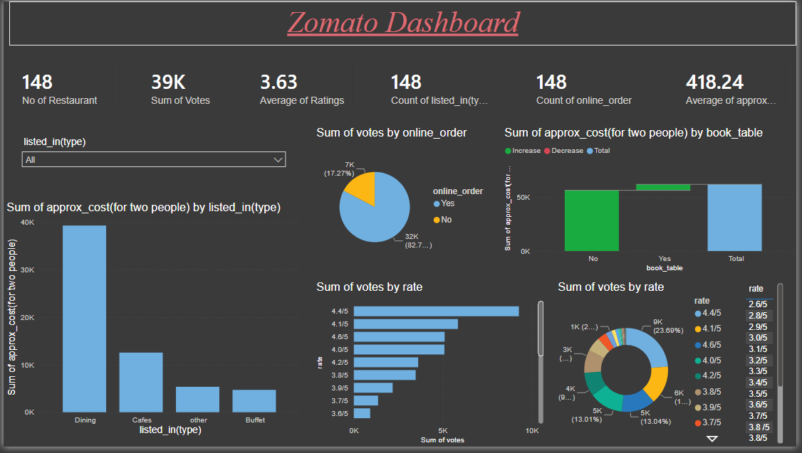

# 🍽️ Zomato Dashboard in Power BI

## 📌 Project Overview

The **Zomato Dashboard in Power BI** is a data analytics project designed to analyze restaurant data and generate meaningful business insights. The dashboard helps understand restaurant distribution, customer ratings, cuisine preferences, pricing trends, and online delivery availability.

The project uses Power BI to transform raw restaurant data into interactive visualizations that support data-driven decision-making.



## 🎯 Objectives

- Analyze the distribution of restaurants across different cities and countries.
- Identify popular cuisines and restaurant categories.
- Evaluate restaurant ratings and customer votes.
- Compare the average cost for two people across cities and restaurants.
- Analyze online ordering and table booking availability.
- Identify top-rated restaurants and key restaurant performance trends.

## 🛠️ Tools and Technologies

- **Power BI Desktop** – Dashboard development and data visualization
- **Power Query** – Data cleaning and transformation
- **DAX (Data Analysis Expressions)** – Calculated measures and KPIs
- **Microsoft Excel / CSV** – Data storage and source files

## 📂 Dataset Description

The dataset contains restaurant-related information, such as:

| Column | Description |
| --- | --- |
| Restaurant ID | Unique restaurant identifier |
| Restaurant Name | Name of the restaurant |
| Country Code | Code representing the country |
| City | Restaurant location |
| Locality | Restaurant neighborhood |
| Cuisines | Types of cuisines offered |
| Aggregate Rating | Overall restaurant rating |
| Votes | Number of customer votes |
| Average Cost for Two | Estimated cost for two people |
| Price Range | Restaurant price category |
| Has Online Delivery | Online delivery availability |
| Has Table Booking | Table reservation availability |

_Note: The actual columns depend on the dataset used in the project._

## 📊 Dashboard Features

### 1\. Key Performance Indicators (KPIs)

- Total Restaurants
- Average Restaurant Rating
- Average Cost for Two
- Total Customer Votes
- Online Delivery Percentage

### 2\. Restaurant Analysis

- Restaurant count by city and country
- Top cities by restaurant count
- Restaurant distribution by price range
- Highest-rated restaurants

### 3\. Cuisine Analysis

- Most popular cuisines
- Restaurant count by cuisine
- Cuisine-wise rating comparison
- Cuisine distribution across locations

### 4\. Customer Rating Analysis

- Distribution of restaurant ratings
- Rating comparison by city
- Votes by restaurant
- Relationship between ratings and customer engagement

### 5\. Online Delivery Analysis

- Restaurants offering online delivery
- Online delivery availability by city
- Comparison of restaurants with and without online delivery
- Table booking availability

## 🧹 Data Cleaning and Transformation

Data preparation is performed using Power Query in Power BI.

The major steps include:

1. Importing the dataset from Excel or CSV.
2. Removing duplicate records where appropriate.
3. Handling missing and inconsistent values.
4. Correcting data types for numerical and categorical columns.
5. Standardizing city, cuisine, and availability values.
6. Checking rating and cost fields for invalid values.
7. Loading the transformed data into Power BI.

## 🧮 DAX Measures

The following sample DAX measures can be used in the dashboard. Update the table and column names to match your dataset.

### Total Restaurants

dax

```
Total Restaurants =
DISTINCTCOUNT('Zomato'[Restaurant ID])
```

### Average Rating

dax

```
Average Rating =
AVERAGE('Zomato'[Aggregate rating])
```

### Average Cost for Two

dax

```
Average Cost for Two =
AVERAGE('Zomato'[Average Cost for two])
```

### Total Votes

dax

```
Total Votes =
SUM('Zomato'[Votes])
```

### Online Delivery Restaurants

dax

```
Online Delivery Restaurants =
CALCULATE(
    [Total Restaurants],
    'Zomato'[Has Online delivery] = "Yes"
)
```

### Online Delivery Percentage

dax

```
Online Delivery Percentage =
DIVIDE(
    [Online Delivery Restaurants],
    [Total Restaurants],
    0
)
```

Format the online delivery percentage measure as a percentage in Power BI.

## 🎨 Dashboard Visualizations

The dashboard can include the following visuals:

- **Card visuals:** Display key performance indicators.
- **Bar charts:** Compare restaurants by city and cuisine.
- **Donut charts:** Show online delivery and table booking availability.
- **Column charts:** Analyze rating and price range distributions.
- **Scatter charts:** Explore the relationship between restaurant ratings and average cost.
- **Maps:** Visualize restaurant distribution geographically, if location data is available.
- **Slicers:** Filter data by city, country, cuisine, rating, and price range.

## 🚀 How to Run the Project

1. Download or clone this repository.
2. Download and install Power BI Desktop.
3. Open the `.pbix` file in Power BI Desktop, if provided.
4. If the dataset is separate, import the Excel or CSV file.
5. Open **Transform Data** to inspect and clean the dataset.
6. Create or review the required DAX measures.
7. Refresh the data and explore the dashboard using the available filters.

## 📈 Expected Outcomes

This project helps users:

- Understand restaurant market distribution.
- Discover popular cuisines and restaurant locations.
- Compare restaurant ratings and pricing.
- Evaluate online delivery adoption.
- Identify patterns in customer votes and restaurant performance.
- Develop practical skills in data analysis and business intelligence.

_Actual findings and KPI values should be calculated from the selected dataset._

## 💡 Future Enhancements

- Add time-based analysis if historical data is available.
- Integrate additional datasets for delivery time and customer orders.
- Develop advanced restaurant segmentation.
- Add drill-through pages for detailed restaurant analysis.
- Publish the dashboard to Power BI Service for sharing.

## 📁 Suggested Repository Structure

text

```
Zomato-PowerBI-Dashboard/
│
├── README.md
├── Zomato_Dashboard.pbix
├── data/
│   └── zomato.csv
├── screenshots/
│   └── dashboard.png
└── docs/
    └── data_dictionary.md
```

## 👨‍💻 Skills Demonstrated

- Data Cleaning and Transformation
- Exploratory Data Analysis
- Data Visualization
- Power BI Dashboard Development
- DAX Measures and KPI Creation
- Business Intelligence and Reporting

## 📌 Conclusion

The Zomato Dashboard in Power BI demonstrates how restaurant data can be transformed into interactive visual insights. It provides an overview of restaurant locations, ratings, cuisine preferences, pricing, and online delivery availability while showcasing practical data analytics and business intelligence skills.

